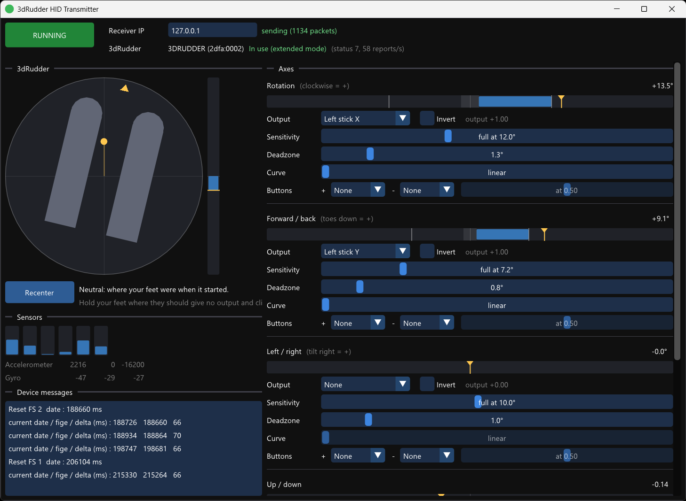

# 3dRudder HID Transmitter

This is a Windows application that lets you use the 3dRudder foot controller as a gamepad. Each of the 3dRudder's four axes (rotation, forward / back tilt, left / right tilt, up / down) can drive an analog stick axis or the analog triggers, and press buttons when pushed past a threshold.

_Please note it's only been tested with the PlayStation version of 3dRudder (the blue one). I don't know anything about the other versions._

It acts as the Transmitter component of a [HID Forwarder](https://github.com/jfedor2/hid-forwarder) setup. The gamepad inputs generated are sent to the configured Receiver. This way you can control a game on the same PC or on a separate computer or console.

You will probably want to use one of the tools from the [HID Router](https://github.com/jfedor2/hid-router) project to combine the inputs generated with the 3dRudder with inputs from other sources like actual game controllers, and to create a virtual controller on your PC (if that's your goal).

For downloads see the [latest release](https://github.com/jfedor2/3drudder-hid-transmitter/releases/latest).

See also: [Face HID Transmitter](https://github.com/jfedor2/face-hid-transmitter), [Voice HID Transmitter](https://github.com/jfedor2/voice-hid-transmitter), [Overlay HID Transmitter](https://github.com/jfedor2/overlay-hid-transmitter), [Wii Balance Board HID Transmitter](https://github.com/jfedor2/wii-balance-board-hid-transmitter).

If you're looking for a way to use the 3dRudder as a mouse, see [3dRudder Mouse](https://github.com/jfedor2/3drudder-mouse).

## Usage

Plug in the 3dRudder and run the program. It finds the 3dRudder by itself, and reconnects if it's unplugged and plugged back in. No software from the manufacturer has to be installed.

- **RUNNING / STOPPED** turns sending inputs on and off.
- The window icon shows the state. The left half is the 3dRudder: yellow when it's connected but not in use (feet not on it), green when it's in use. The right half is red when sending is stopped, green when running. The whole circle is red when no 3dRudder is found.
- **Receiver IP**: the IP of the receiver. Inputs go to UDP port 42734.
- The **3dRudder** area shows the device and its status. Put both feet on it and keep them still for a moment. The status goes to "In use", and the 3dRudder takes the current position of your feet as neutral. The output is centered whenever it's not in use.
- The **top-down view** shows the feet turned by the rotation and the tilt as a yellow dot. The bar next to it is up / down.
- **Recenter** takes the current position as neutral, for when the rotation drifts or you want a different neutral. It's forgotten when you take your feet off, because the 3dRudder sets a new neutral itself when they go back on. **Reset** goes back to the 3dRudder's own neutral.
- **Sensors** shows the six force sensors and the raw accelerometer and gyro readings.
- **Device messages** are the debug messages the firmware sends.
- Under **Axes**, each axis has a bar with the current value (yellow marker), the deadzone (shaded), the points of full output (white lines), the button thresholds (orange ticks) and the output (blue).
  - **Output**: the stick axis or triggers this axis drives. For sticks, the + side (clockwise, toes down, tilt right) moves the stick right / up. "L2 / R2" puts the + side on R2 and the - side on L2. Several axes can drive the same output, and they add up.
  - **Invert** swaps the + and - sides.
  - **Sensitivity**: how far from neutral for full output. Lower = more sensitive.
  - **Deadzone**: how far from neutral with no output.
  - **Curve**: 1 is linear. Higher values give finer control near neutral and still reach full output at the same point.
  - **Buttons**: a button for each side, pressed when the axis goes past the threshold, which runs from 0 (just outside the deadzone) to 1 (full). The buttons work with or without an analog output. For example, you can put rotation on the D-pad or make up / down jump.
- **Reset to defaults** puts all the axis settings back. By default, rotation drives the left stick X and forward / back drives the left stick Y.
- **Output** shows the sticks, triggers and buttons being sent.

Settings are saved automatically to `%APPDATA%\3drudder-hid-transmitter\3drudder-hid-transmitter\settings.json`.

Pass `--start` on the command line to start in the running state.

## Protocol

The device has one vendor-defined HID interface (usage page `0xff00`) and sends 64-byte input reports with report ID 1. It starts sending as soon as it's plugged in. Byte 2 is the message type:

| Type | Message |
|------|---------|
| `f5` | Sensor data, about 60 per second (layout below). |
| `f4` | Status change events. |
| `fd` | Debug text from the firmware: byte 3 is a counter, ASCII text from byte 4. |

Sensor data (byte offsets include the report ID):

| Bytes  | Contents |
|--------|----------|
| 3      | Counter |
| 4      | Status: 3 = put your feet on, 4 = put your second foot on, 5 = stay still, 6 = in use, 7 = in use (extended mode) |
| 6-9    | Rotation, degrees, float (clockwise = +) |
| 10-13  | Forward / back tilt, degrees, float (toes down = +) |
| 14-17  | Left / right tilt, degrees, float (tilt right = +) |
| 18-21  | Up / down, -1 to 1, float |
| 22-25  | ? |
| 26-37  | Six force sensors, uint16 |
| 38-43  | Accelerometer X / Y / Z, int16 (16384 = 1 g) |
| 44-49  | Gyro X / Y / Z, int16 |

The axes are relative to where the feet were when the 3dRudder finished initializing. They're only meaningful while the status is 6 or 7.

## License and acknowledgements

The software in this repository is licensed under the [MIT License](LICENSE).

The UI uses [Dear ImGui](https://github.com/ocornut/imgui) (MIT) and configuration uses [nlohmann/json](https://github.com/nlohmann/json) (MIT).
